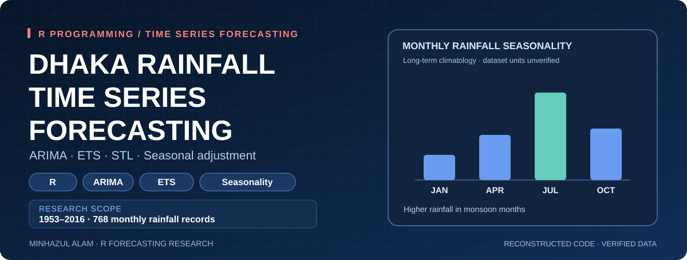
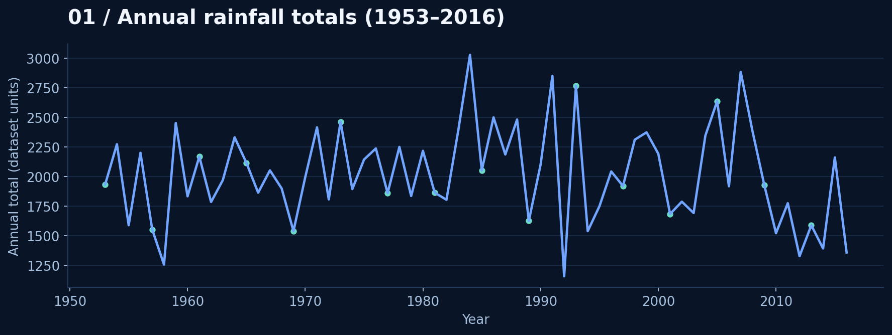
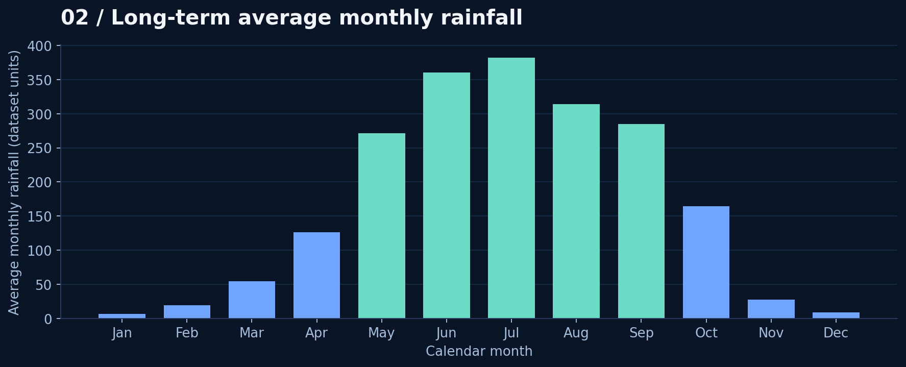
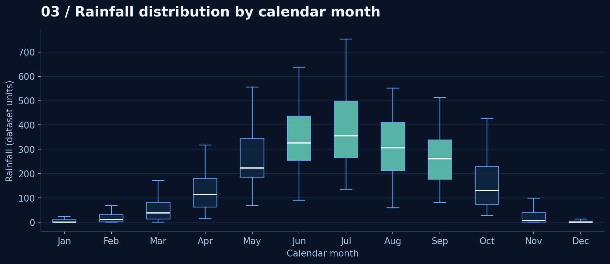
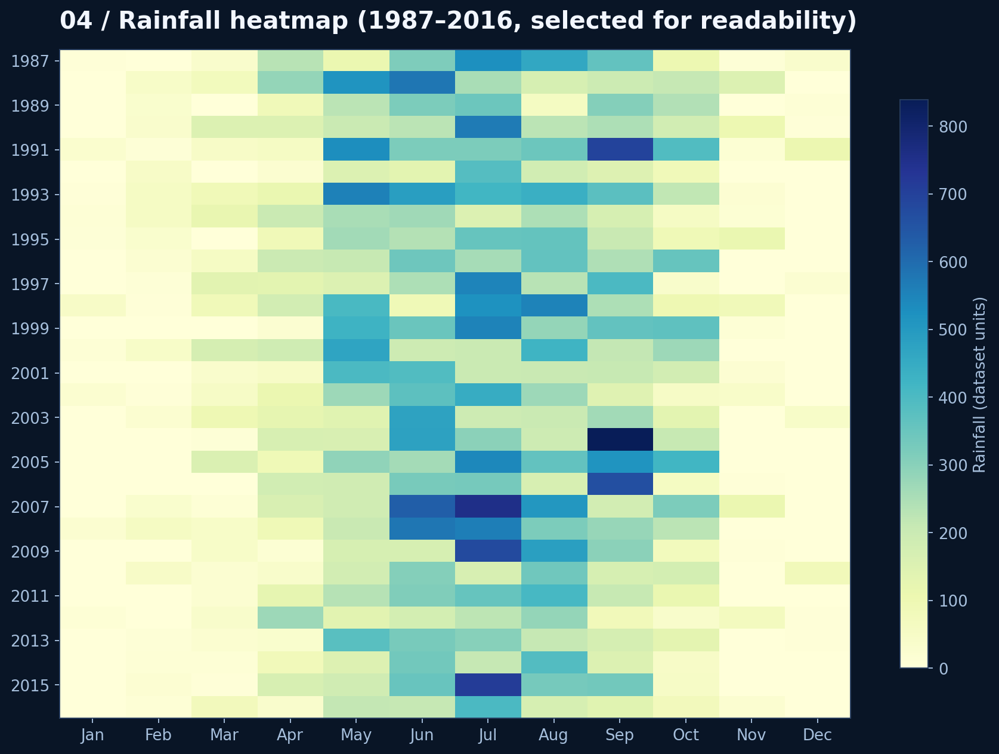
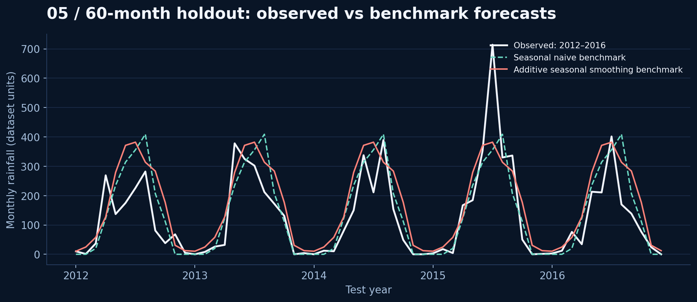
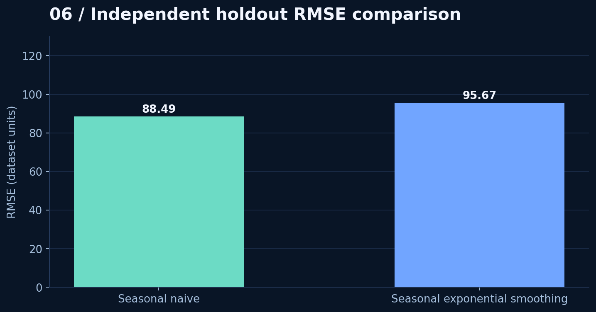
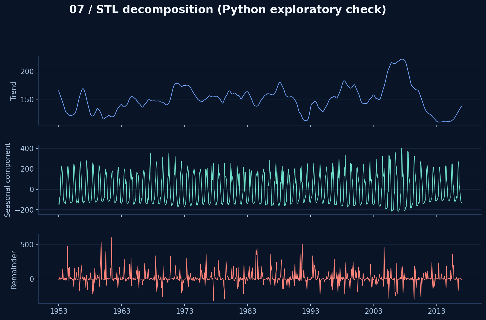

<div align="center">



### Seasonal rainfall patterns · ARIMA · ETS · Statistical forecasting

**R · Time Series Analysis · Seasonal Adjustment · Forecast Evaluation**

</div>

## Research overview

**Research title:** *Forecasting with Seasonal Adjustment - An Application to Rainfall Data in Dhaka*  
**Research &amp; manuscript:** **Minhazul Alam**  
**Period studied:** January 1953 to December 2016 (768 monthly records)  
**Research focus:** Rainfall seasonality, ARIMA / ETS forecasting, seasonal adjustment, model comparisons.

This project reconstructs the R forecasting workflow described in Minhazul Alam's rainfall research manuscript. The original thesis contains ARIMA, ETS, STL adjustment, model diagnostics, and accuracy tables, but **the original R source code is unavailable**. The included `src/analysis.R` was reconstructed separately, and it was successfully executed in RStudio. **No original R code is claimed to have been recovered.**

## Source validation

| Check | Finding |
|---|---|
| Rows / fields | 768 monthly records / 4 columns (`YEAR`, `Month`, `Max Temp`, `Rainfall`) |
| Coverage | 1953-01–2016-12 (64 continuous years) |
| Missing months and values | 0 / 0 |
| Zero-rainfall observations | 107 |
| Most rainy climatological month | July (mean 382.1 in dataset units) |
| Measurement units | Not established from supplied source; charts use **dataset units** |

## Research and reconstructed models

- **ARIMA:** Seasonal time-series modelling, identification and forecast evaluation.
- **ETS:** Exponential smoothing for time-dependent seasonal patterns.
- **STL + ARIMA / STL + ETS:** Seasonally decomposed forecasting using R's `forecast::stlm()` workflow.
- **Diagnostic checks:** Model residuals and seasonal patterns.
- **Evaluation:** Train on 1953–2011, reserve 2012–2016 as a 60-month holdout; compare RMSE and MAE.

## Verified independent holdout check

These benchmark numbers were calculated independently in **Python**, using the supplied CSV and the stated 60-month test window. They are *not* results from the unexecuted R script or directly comparable to the manuscript's reported results.

| Benchmark (Python) | Test RMSE | Test MAE |
|---|---:|---:|
| Seasonal naive | **88.49** | **57.69** |
| Additive seasonal exponential smoothing | 95.67 | 69.63 |

The seasonal-naive forecast performs better on this particular test window; it is not evidence of universal superiority over ARIMA or ETS, which require equivalent out-of-sample comparisons. MAPE is not emphasized because rainfall is zero in 107 source observations.

## Visual research gallery

### 01 · Annual rainfall history



### 02 · Long-run seasonal pattern



### 03 · Monthly variability



### 04 · Rainfall heatmap



### 05 · Out-of-sample benchmark forecasts



### 06 · Benchmark model accuracy



### 07 · STL decomposition



> **Transparency:** All seven preview charts were generated from the user-provided CSV using Python for independent review, not claimed to be generated by the reconstructed R script. The dataset is not included publicly pending provenance/redistribution permission.

## Verified R Execution Results

**Environment:** R 4.4.2, forecast 8.24.0

**Holdout:** January 2012 – December 2016 (60 months)

| Model | RMSE | MAE |
|---|---:|---:|
| Seasonal Naive | 88.49 | 57.69 |
| Auto-ARIMA | 90.10 | 57.70 |
| STL + ARIMA | 91.20 | 71.02 |
| STL + ETS | 91.23 | 71.08 |
| ETS | 95.90 | 68.80 |

**Diagnostic finding:** Auto-ARIMA residuals show
significant remaining autocorrelation (Ljung-Box
p ≈ 0.0000187).

These results come from the successfully executed
reconstructed R script, not the original thesis code.

[Verified R Results](results/r_model_holdout_comparison.csv)

## Reproduce in R

1. Install R and the CRAN package `forecast` (`install.packages("forecast")`).
2. Place an authorized local CSV at `data/Dhaka_RT.csv` with columns `YEAR, Month, Max Temp, Rainfall`.
3. Run from the repository root:

```bash
Rscript src/analysis.R data/Dhaka_RT.csv
```

The script reconstructs **Auto-ARIMA, ETS, STL + ARIMA, STL + ETS**, and seasonal naive comparison methods, exporting model evaluation and charts. The R implementation has successfully tested in RStudio using R 4.4.2; verify locally before citing its outputs.

## Source and result limitations

The original manuscript reports ARIMA/ETS RMSE values on p. 9, while p. 6 contains different values and incomplete placeholders. Those manuscript-derived numbers are preserved in `results/manuscript_reported_metrics_UNVERIFIED.csv` **without claiming verification**. The original accuracy protocol, forecast origin and rainfall unit are not established. See [Methods and verification](docs/METHODS_AND_VERIFICATION.md).

## Project structure

```text
README.md
assets/banner.svg
assets/banner_preview.png
figures/01...07_*.png
src/analysis.R
results/independent_python_holdout_benchmark.csv
results/monthly_rainfall_climatology.csv
results/manuscript_reported_metrics_UNVERIFIED.csv
data/README.md
docs/METHODS_AND_VERIFICATION.md
```

## Research credit

**Research and manuscript:** Minhazul Alam. The R script in this repository is a **new reconstruction** for portfolio reproducibility, not the original code. The source manuscript and raw observational dataset are not redistributed.

---

[GitHub Portfolio](https://github.com/minhaz6996) · [Related Climate & Agriculture R Project](https://github.com/minhaz6996/climate-crop-yield-r-analysis)
